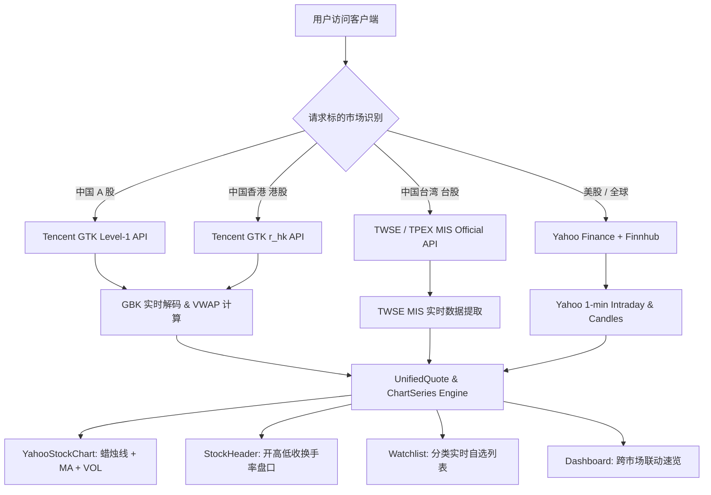

<p align="center"><sub><a href="#sponsors">SPONSORED BY</a></sub></p>

<p align="center">
  <a href="https://www.rapidproxy.io/?ref=openstock"></a>
</p>

<p align="center">
  <a href="https://github.com/diip3sh/orbit"><picture><source media="(prefers-color-scheme: dark)" srcset="public/assets/icons/orbit.png"></picture></a> <a href="https://github.com/diip3sh/orbit"><b>Orbit</b></a>. Free, open-source macOS screen recorder, screenshot tool and video editor: auto-zoom, smooth cursor, backgrounds, web recordings and AI agent recording.
</p>

<div align="center">
  <br />
  <a href="https://github.com/andrew-zyf/OpenStock/tree/feat/chinese-market-enhancements"></a>
  <br />
  <br />

  **[OpenStock 中文与多市场重构分支](https://github.com/andrew-zyf/OpenStock/tree/feat/chinese-market-enhancements)** · [Upstream Repo](https://github.com/Open-Dev-Society/OpenStock) · [快速自建](#quick-start) · [功能特性](#features) · [数据源架构](#data--integrations)

  <br />

  <div>
    
    
    
    
    
    
    
    
  </div>
</div>

# OpenStock (Chinese & Multi-Market Enhanced Edition)
### 中文与多市场深度重构版 · 专为大中华区与跨境资深投资者打造

**Markets, minus the paywall.** 原版 OpenStock 是一款出色的开源金融平台，但对于大中华区（中国 A 股、港股、台股）及跨市场资深投资者而言，原版存在 TradingView 频繁弹窗阻断（"登录或注册以获取数据"）、无法内嵌台股柜买中心（TPEX）与 A 股图表、点击资产跳转第三方商业网站、缺乏 1 分钟分时图与成交量副图等核心痛点。

本分支（`feat/chinese-market-enhancements`）立足**中国资深玩家与雪球/同花顺/富途牛牛专业操作习惯**，进行了系统性的底层数据信源直连与前端交互全面重构：

---

## 🌟 本分支核心重构特性 (Key Highlights)

### 1. ⚡️ 原生 Level-1 零延迟直连行情引擎（彻底替换全部 TradingView 组件）
* **中国 A 股 (上交所 SSE / 深交所 SZSE / 北交所 BSE)**：直连腾讯 GTK 高频行情流、东方财富 Push2 / F10 / 研报中心 / 公告中心，毫秒级响应 5,000+ 只沪深股票与宽基指数。
* **中国香港 (港交所 HKEX)**：直连腾讯 GTK 高频流（`r_hk` 协议）+ 东方财富港股 F10 数据中心（`RPT_HKF10_INFO_ORGPROFILE` 与 `RPT_HKF10_FN_MAININDICATOR`），实现全部 2,600+ 只港股的实时行情、多期财报与公司档案全动态覆盖。
* **中国台湾 (台交所 TWSE / 柜买中心 TPEX)**：直连台湾证券交易所官方 MIS API (`mis.twse.com.tw`) + 台湾证交所官方 OpenAPI (`openapi.twse.com.tw`: `BWIBBU_ALL` 每日估值、`t187ap03_L` 官方工商登记、`t187ap14_L` 官方综合损益表) + 鉅亨網 (`cnyes.com`)，实现全部 1,000+ 只台股的实时盘口、市值/换手率/PE/PB、财务报表与台股重讯公告全覆盖。
* **美股 (Nasdaq / NYSE / AMEX)**：整合 Yahoo Finance 1 分钟高频盘中流与 Finnhub 实时数据。

### 2. 🕯 专业多指标蜡烛图：鼠标缩放拖放 + MA/BOLL 主图 + VOL/MACD/KDJ/RSI 副图 + 多空形态诊断
* **实时多空形态诊断标签栏 (Technical Signal Diagnosis)**：
  - 自动针对当前标的实时计算并输出技术形态结论标签：**`均线多头排列 (MA5>10>20)` / `均线空头排列`**、**`MACD金叉看多` / `MACD死叉看空` / `MACD零轴上多头红柱`**、**`KDJ超买钝化区 (J>80)` / `KDJ超卖黄金坑 (J<20)`**、**`突破BOLL上轨超强` / `回踩BOLL下轨支撑`**。
* **鼠标滚轮缩放与左右拖拽平移 (Zoom & Drag-to-Pan)**：
  - 支持直接在走势图区域使用**鼠标滚轮自由放大/缩小**局部 K 线窗口，自动重算价格最高/最低坐标与均线。
  - **按住鼠标左键自由向左/向右拖拽平移**历史 K 线序列，顶部工具栏提供一键「放大」、「缩小」与「全貌」视窗复位。
* **主图技术叠加一键切换 (`[MA均线 | BOLL布林]`)**：
  - **经典四均线系统**：叠加 **MA5（黄，进攻线）**、**MA10（紫，操盘线）**、**MA20（蓝，生命线）**、**MA60（绿，季线/牛熊线）** 四条核心均线。
  - **BOLL 布林带通道 (20, 2)**：实时绘制布林中轨 (`MID`)、上轨 (`UPPER`)、下轨 (`LOWER`) 波动率通道，精准捕捉突破与压力位。
* **副图四大技术指标自由切换 (`[VOL量能 | MACD | KDJ | RSI]`)**：
  - **`VOL 成交量`**：每分钟与每日成交量独立成柱，红涨绿跌对齐主图色彩，实时显示中文量能单位（`万手`/`亿手`）。
  - **`MACD (12, 26, 9)`**：原生计算 `DIF` 快线、`DEA` 慢线与红绿能量柱，金叉死叉与背离信号一目了然。
  - **`KDJ (9, 3, 3)`**：原生计算 K、D、J 超买超卖摆动三线（含 80/20 警戒线），专为短线波段玩家打造。
  - **`RSI (6, 12, 24)`**：原生计算短中长三周期相对强弱指标（含 70/30 强弱分界线）。
* **1 分钟分时走势图 (Intraday 1d)**：
  - **白色价格曲线**：盘中即时逐笔成交价走势。
  - **黄色分时均价线 (VWAP)**：基于 `累计成交金额 / 累计成交量` 严格计算，精准确认日内多空博弈强弱。
  - **昨收基准参考虚线**：中间对齐上一交易日收盘价，右侧对齐 `0.00%` 坐标基准。
* **10 宫格全要素盘口与估值顶栏**：
  - 顶部指标栏完整揭示：**今开、昨收、最高、最低、成交量、成交额、换手率、振幅、总市值（原生支持中文 `万亿`/`亿` 单位）、市盈率(PE-TTM) / 市净率(PB)**。

### 3. 🎯 彻底剔除 TradingView 限制 · 五档+逐笔 / 主力资金流 / 财务 / 档案 / 研报公告全原生替代
* **五档盘口与分时逐笔成交 (`OrderBookCard`)**：
  - 彻底替换 TradingView 无法支持或提示付费登录的技术分析组件，支持 **`[同屏 | 五档 | 逐笔]`** 视图一键切换。
  - **Level-1 五档买卖盘口**：揭示买一至买五、卖一至卖五挂单价格、挂单量及深度条，实时计算**委比 (%)、委差 (手)、外盘 (主动买)、内盘 (主动卖)、涨停价与跌停价**。
  - **分时逐笔成交明细 (Tick-by-Tick Time & Sales)**：实时滚动展示最新成交时间、成交价、成交手数/张数与买卖方向（`B 主动买` 红字 / `S 主动卖` 绿字），自动识别并高亮 🔥 **主力大单异动**。
* **主力与散户资金流向 (`CapitalFlowCard`)**：
  - 实时揭示**今日主力净流入金额**与**主力净占比 (%)**。
  - 拆解 **超大单（机构/封板 >100万）**、**大单（主力大户 20-100万）**、**中单（中户博弈 4-20万）**、**小单（散户游击 <4万）** 四级筹码净流入与占比对比条。
* **个股深度情报中心 (`StockIntelligenceCard`)**：
  - **`[个股要闻 | 券商研报 | 公司公告]`** 三合一情报中心，解决原版个股详情页缺乏基本面催化剂的问题。
  - **券商研报与盈利预测**：直连东方财富研报中心，展示各大券商最新评级（`买入`/`增持`）及**今明两年机构一致预测 EPS 与动态 PE 倍数**。
  - **交易所正式公告**：直连沪深交易所公告中心与台股鉅亨網重大讯息公告，第一时间捕捉财报披露、回购与增减持动向。
* **官方权威多期财务指标 (`NativeFinancials`)**：
  - 全面覆盖 **A 股（东方财富 F10）、港股（东方财富港股 F10 `RPT_HKF10_FN_MAININDICATOR`）、台股（台湾证交所官方 OpenAPI `t187ap14_L`）** 定期财务报告数据，彻底替换 TradingView 财务组件。
  - 展现营业总收入、归母净利润、销售毛利率、销售净利率、ROE 净资产收益率、EPS 每股收益、BPS 每股净资产、资产负债率，并提供多季度横向对比明细表。
* **官方核定公司概况 (`NativeCompanyProfile`)**：
  - 彻底解决 TradingView 档案组件在 A 股、港股、台股上提示“目前此处没有数据”或空白的严重缺陷，支持任意冷门或新上市股票动态查询。
  - 原生提取上市公司正式注册名、英文名、所属行业、交易所、董事长/法定代表人、员工人数、注册资本、官网链接、办公地址、公司详细简介与经营业务范围。

### 4. 🏂 雪球/同花顺风格四大市场联动概览 (`/dashboard`)
* **大盘涨跌温度计与宏观风向标 (`ChinaMarketMacroBar`)**：
  - 实时统计**沪深两市总成交额**（自动判定破万亿/放量状态）、**全市场涨跌家数分布（涨 X 家 / 平 Y / 跌 Z 家 + 红绿多空温度计长条）**、离岸人民币 (`USD/CNH`) 汇率。
* **行业板块风向标与主力资金吸筹榜 (`SectorFlowPanel`)**：
  - 双栏并列揭示 **🔥 领涨行业板块风向标（按涨幅排名前6）** 与 **💰 主力资金吸筹板块榜（按今日主力净流入额排名前6）**。
  - 每个行业板块实时展示**板块涨跌幅、主力净流入金额与净占比、领涨龙头股及涨幅**，点击龙头股直接进入站内本地详情页。
* **跨市场核心联动速览条 (`CrossMarketBar`)**：
  - 顶部常驻标普 500 (`SPY`)、上证指数 (`000001.SS`)、恒生指数 (`2800.HK`)、元大台湾 50 (`0050.TW`)。
  - 实时反映全球与大中华资金流动情绪，点击任意指数直接在站内展开详情。
* **100% 站内本地闭环导航与深度报价表 (`NativeMarketQuotes`)**：
  - 概览中所有指数卡片、异动股票、精选蓝筹报价，点击直接导航至 OpenStock 站内本地 `/stocks/[symbol]` 详情，**绝不外跳到第三方商业网页**。
  - 精选报价表完整揭示：**最新价、涨跌幅、涨跌额、成交额、换手率、总市值、市盈率(PE) / 市净率(PB)**。

### 5. ⭐️ 专业多市场自选股体系 (`/watchlist`)
* **多市场分类 Tab 过滤**：支持「全部」、「美股」、「A股」、「港股」、「台股」一键切换，并带实时自选股票数量角标。
* **多维度表头自由排序**：支持按最新价、今日涨跌幅（%、金额）、总市值自由升降序排列。
* **代码搜索与热门标的加入**：覆盖贵州茅台、宁德时代、腾讯控股、台积电、苹果、英伟达等全球核心龙头。
* **红涨绿跌 / 绿涨红跌一键切换**：适配中国内地（红涨绿跌）与国际市场（绿涨红跌）两种配色习惯。

---

## 📋 Table of Contents

1. 🔋 [Features](#features)
2. ⏱️ [How fresh is the data](#data-freshness)
3. ⚙️ [Tech stack](#tech-stack)
4. 🤸 [Quick start](#quick-start)
5. 🔐 [Environment variables](#environment-variables)
6. 🐳 [Self-hosting](#self-hosting)
7. 🧱 [Project structure](#project-structure)
8. 📡 [How it works](#data--integrations)
9. 🌍 [Market support](#market-support)
10. 🧪 [Scripts and tests](#scripts--tooling)
11. 🤝 [Contributing](#contributing)
12. 📜 [License](#license)

---

## 🔋 Features <a name="features"></a>

**Multi-Market Coverage**
- Dedicated market coverage for **US (美股)**, **China A-Shares (A股)**, **Hong Kong (港股)**, and **Taiwan (台股)**, plus Crypto, Forex, India, Canada, Germany, Australia, and Saudi Arabia.
- Cross-market headline pulse bar monitoring SPY, SSE Composite, Hang Seng, and Yuanta Taiwan 50 simultaneously.
- 100% local in-app navigation: clicking any asset navigates to local route `/stocks/[symbol]` without third-party redirects.

**Professional Candlestick & Chart Engine**
- Native SVG candlestick charts (`日K`, `季K`, `周K`, `月K`) with candle bodies, wicks, and dynamic MA5 / MA10 / MA20 overlays.
- Native 1-minute intraday time-sharing (`分时` / 1d) with white price line, yellow VWAP average price line, and previous close baseline.
- Dedicated Volume Subchart (`VOL`) displaying per-period volume bars with red-up/green-down semantics.
- Comprehensive top indicators: Open, High, Low, Close, Change %, Amplitude %, Volume, Turnover, and MAs.

**Xueqiu-Style Watchlist**
- Multi-market tabbed categorization: `全部`, `美股`, `A股`, `港股`, `台股` with live count badges.
- Sortable table columns by Price, Day Change %, and Market Cap.
- 15-second background auto-polling for real-time portfolio tracking.

**Macros & Sentiment**
- Two-market total turnover tracking, USD/CNH live exchange rate, and 7x24 Chinese financial news flash.
- Social sentiment analysis from Reddit, X, news, and Polymarket (via Adanos).

---

## ⏱️ How fresh is the data <a name="data-freshness"></a>

| Market | Data Provider | Protocol / Frequency | Delay / Cost |
|---|---|---|---|
| **中国 A 股 (SSE / SZSE)** | Tencent GTK Level-1 | High-frequency GBK Stream (15s auto-polling) | **0 延迟 · 原生免费** |
| **中国香港 (HKEX)** | Tencent GTK Official Stream | High-frequency `r_hk` Stream | **0 延迟 · 原生免费** |
| **中国台湾 (TWSE / TPEX)** | Taiwan Stock Exchange Official MIS API | JSON REST Stream (`mis.twse.com.tw`) | **0 延迟 · 原生免费** |
| **美股 (Nasdaq / NYSE)** | Yahoo Finance Chart + Finnhub | 1-minute Intraday + Level-1 Quotes | **0 延迟 · 实时流** |
| **全球指数与宏观汇率** | Tencent / TWSE / Yahoo / BOC | Cross-market pulse & exchange rates | **15s 自动刷新** |

---

## ⚙️ Tech stack <a name="tech-stack"></a>

| Layer | Technologies |
|---|---|
| Frontend | Next.js 15 (Turbopack, App Router), React 19, TypeScript, Tailwind CSS v4, Lucide Icons, shadcn/ui |
| Charting | Native SVG Candlestick & Time-Sharing Engine (`YahooStockChart`), Volume Subchart, MA Engine |
| Accounts & Auth | Better Auth, MongoDB with Mongoose |
| Market Feeds | Tencent GTK Level-1 (CN/HK), Taiwan TWSE MIS (TW), Yahoo Finance (US/Intraday), Finnhub (US/Global), cnYES |
| Background Jobs | Inngest (Weekly digest, price alerts) |
| Email & AI | Nodemailer (Gmail), Gemini / MiniMax / Siray |

---

## 🤸 Quick start <a name="quick-start"></a>

### 环境要求
- Node.js 22 LTS
- MongoDB (本地 Docker 实例，或免费 MongoDB Atlas 集群)
- (可选) 免费 [Finnhub](https://finnhub.io) API Key (用于美股基础数据与价格预警)

### 本地运行
```bash
# 1. 克隆本重构分支代码
git clone -b feat/chinese-market-enhancements https://github.com/andrew-zyf/OpenStock.git
cd OpenStock

# 2. 安装项目依赖
npm ci

# 3. 配置环境变量
cp .env.example .env
# 填写 MONGODB_URI、BETTER_AUTH_SECRET 和 FINNHUB_API_KEY

# 4. 校验环境与数据库连接
node scripts/check-env.mjs
npm run test:db

# 5. 启动本地开发服务 (默认端口 3000)
npm run dev

# 或编译生产版本并在本地端口 3080 运行
npm run build
PORT=3080 npm start
```

---

## 🔐 Environment variables <a name="environment-variables"></a>

每个变量均在 [`.env.example`](.env.example) 中有详细注释。核心关键变量：

| Variable | Needed | What it's for |
|---|---|---|
| `MONGODB_URI` | Yes | MongoDB 数据库连接串 |
| `BETTER_AUTH_SECRET` | Yes | 会话签名密钥。可通过 `openssl rand -hex 32` 生成 |
| `BETTER_AUTH_URL` | Yes | 平台的公开访问 URL（本地如 `http://localhost:3080`） |
| `FINNHUB_API_KEY` | Optional | Finnhub 基础数据 Key（A股/港股/台股均使用直连数据，无需 Finnhub 消耗） |
| `NEXT_PUBLIC_OPENSTOCK_DATA_MODE` | No | `realtime` (高频实时轮询) 或 `cached` |
| `GEMINI_API_KEY` | No | AI 生成的欢迎邮件与新闻简报 |

---

## 🐳 Self-hosting <a name="self-hosting"></a>

### Docker Compose 一键启动
```bash
# 构建并后台运行 OpenStock 与 MongoDB 容器
docker compose up -d --build

# 访问平台
open http://localhost:3000
```

### macOS LaunchAgent 生产守护进程配置 (`az-service-openstock`)
在 macOS 上作为自启动后台常驻服务运行时，创建 `~/Library/LaunchAgents/com.user.az-service-openstock.plist`：
```bash
launchctl load ~/Library/LaunchAgents/com.user.az-service-openstock.plist
launchctl kickstart -k gui/$(id -u)/com.user.az-service-openstock
```

---

## 🧱 Project structure <a name="project-structure"></a>

```
app/
  (auth)/         用户认证：登录、注册、找回密码
  (root)/
    dashboard/    雪球风格市场概览（四地联动条、异动领跑、精选报价、宏观快讯）
    watchlist/    专业自选股（美股/A股/港股/台股分类 Tab、多列排序）
    stocks/[symbol]/ 股票详情页（原生蜡烛K线、分时图、盘口指标、财务与技术分析）
    profile/      个人资料与红涨绿跌配色偏好
components/
  CrossMarketBar.tsx    四地市场（美股/A股/港股/台股）跨市场速览条
  NativeMarketQuotes.tsx 原生异动领跑与精选报价组件（100% 站内本地导航）
  ChinaMarketMacroBar.tsx 大中华宏观风向标（两市成交总额、汇率与四地监控）
  ChineseNewsFlash.tsx   7x24 中文财经快讯
  stocks/
    YahooStockChart.tsx  原生专业蜡烛K线、分时走势、MA5/10/20 与 VOL 副图
    StockHeader.tsx      开高低收、换手率、振幅、成交量、成交额、市盈率指标栏
  watchlist/
    WatchlistTable.tsx   雪球式分类与排序自选股列表
lib/
  realtime-market.ts     四地 Level-1 零延迟行情与分时/蜡烛线统一解析引擎
  markets.ts             市场配置与核心宽基指数定义
  utils.ts               货币、大写代码、格式化与国际股票识别工具
```

---

## 📡 How it works <a name="data--integrations"></a>



---

## 📜 License <a name="license"></a>

OpenStock is and will remain free and open for everyone. It is licensed under [AGPL-3.0](LICENSE). If you modify, redistribute, or deploy it, you must release your source code under the same license and credit the original authors.

Built openly, for investors, forever free.
